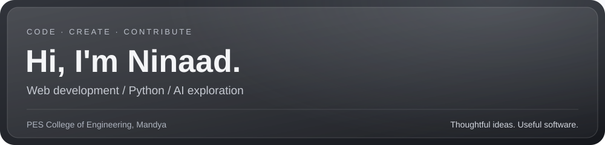
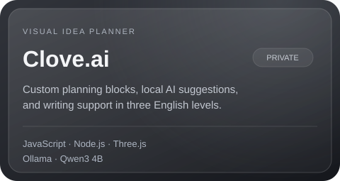
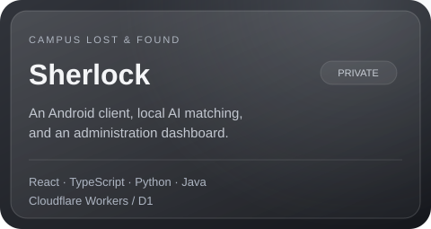

**Student at PES College of Engineering, Mandya | Web development, Python & AI exploration**

I build practical, thoughtfully designed software that turns everyday ideas into useful tools. My projects span web interfaces, Python programming, and systems that connect software with real-world problems.

## Featured projects

<table>
<tr>
<td width="50%"></td>
<td width="50%"></td>
</tr>
</table>

Project details and full technology stack

| Project | What it does | Technologies |
| --- | --- | --- |
| **Clove.ai** (private) | Visual idea planner with custom blocks, local AI recommendations, and writing suggestions in Beginner, Intermediate, and Advanced English. | JavaScript, HTML/CSS, Node.js, Three.js, Ollama, Qwen3 4B |
| Sherlock (private) | College lost-and-found platform with an Android client, local AI-assisted image and text matching, and a laptop administration dashboard. | React, TypeScript, Node.js, Python, Java, Cloudflare Workers/D1 |

## Open-source contributions

**Open-source contributor to 5 projects, with 7 merged pull requests.**

I contribute bug fixes, documentation, diagnostic rules, and regression tests, with a focus on reliable behavior and clear validation.

| Project | Merged contributions | Accepted pull requests |
| --- | --- | --- |
| [ADIF Parser](https://github.com/iu4pra/adif_parser) | QSL generation and template documentation, a CLI grouping-default fix with regression tests, and fork CI fixes. | [#83](https://github.com/iu4pra/adif_parser/pull/83) |
| [femto](https://github.com/codewithzaqar/femto) | Configuration and keybinding references, working customization examples, and README corrections. | [#59](https://github.com/codewithzaqar/femto/pull/59) |
| [localhost-doctor](https://github.com/Jazzfer-2003/localhost-doctor) | nginx diagnostic rules for port conflicts, directory-index errors (403), and refused upstream connections (502), with regression tests. | [#5](https://github.com/Jazzfer-2003/localhost-doctor/pull/5) |
| [monitoring-bot](https://github.com/Urushihara24/monitoring-bot) | Offline storefront HTML fixtures and price-parser regression tests, including safe handling of incomplete prices. | [#62](https://github.com/Urushihara24/monitoring-bot/pull/62) |
| [Judgment Pack Specification](https://github.com/Judgment-Pack/judgment-pack-spec) | JSON Schema conformance tests for missing required fields, unexpected nested fields, and duplicate array entries. | [#152](https://github.com/Judgment-Pack/judgment-pack-spec/pull/152), [#153](https://github.com/Judgment-Pack/judgment-pack-spec/pull/153), [#154](https://github.com/Judgment-Pack/judgment-pack-spec/pull/154) |

*Only merged contributions are listed. Implementation and validation used AI assistance.*

## Tools I use

**Languages:** Python, JavaScript, C, HTML, CSS  
**Web & hardware:** React, Flask, Tailwind CSS, Socket.IO, Arduino  
**Development tools:** Git, GitHub, Vite

## Current focus

- Building clear, responsive web experiences.
- Strengthening programming fundamentals through hands-on projects.
- Exploring AI and practical automation.
- Improving the usability and documentation of the software I build.

## Let's connect

I'm open to collaborations and internship opportunities, especially projects where I can learn, contribute, and build useful software.

[Email me](mailto:ninaadpadiyarr@gmail.com) · [Explore my repositories](https://github.com/ninaad-padiyarr?tab=repositories)

---

> Good software should feel calm, clear, and useful.
